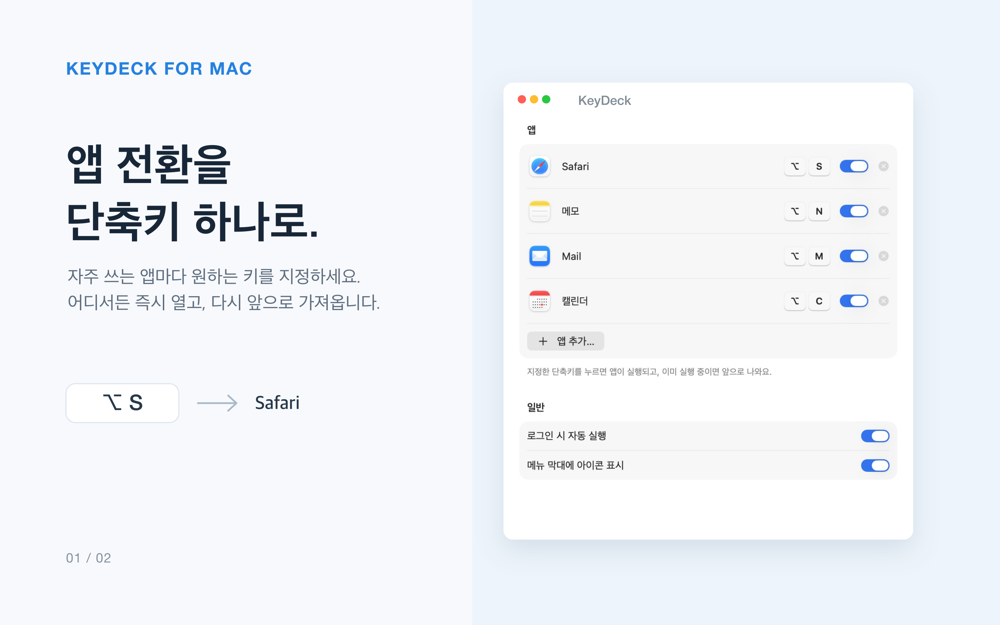
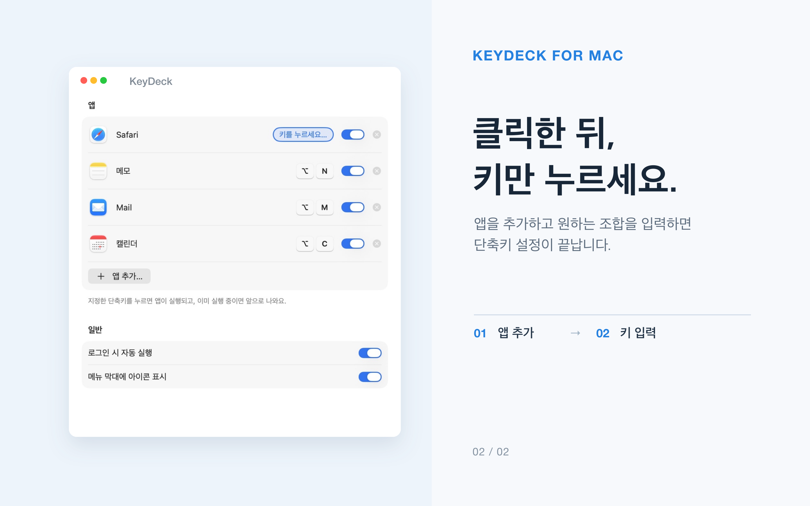

# KeyDeck · 키덱

**단축키 하나로, 원하는 앱을 바로.**

키보드를 Mac 전용 스트림덱으로 바꿔 주는 작은 메뉴 막대 앱

[English](README.md) · 한국어

 

  

## 왜 KeyDeck인가요

Dock을 뒤지거나 ⌘-Tab을 열 번씩 누를 필요가 없습니다. 매일 쓰는 앱마다 단축키를 하나씩 정해 두세요. <kbd>⌥</kbd><kbd>S</kbd>는 Safari, <kbd>⌥</kbd><kbd>N</kbd>은 메모. 누르는 순간 바로 눈앞에 나타나고, 한 번 더 누르면 원래 쓰던 앱으로 돌아갑니다.

- **실행과 전환을 한 번에**: 꺼져 있으면 실행하고, 켜져 있으면 앞으로 가져옵니다.
- **한 번 더 누르면 되돌아가기**: 같은 단축키를 다시 누르면 방금 쓰던 앱으로 바로 돌아갑니다.
- **Finder까지 어떤 앱이든**: 응용 프로그램 폴더에서 고르거나, 지금 실행 중인 앱 목록에서 바로 추가할 수 있습니다.
- **자유로운 조합**: <kbd>⌃</kbd> <kbd>⌥</kbd> <kbd>⇧</kbd> <kbd>⌘</kbd>와 문자·숫자·기호를 마음대로 조합할 수 있습니다.
- **겹침 걱정 없이**: 이미 쓰고 있는 단축키는 지정하는 순간 바로 알려 줍니다.
- **조용하게**: 메뉴 막대에만 머물고, 원하면 아이콘도 숨길 수 있습니다.
- **Mac과 함께 시작**: 로그인할 때 자동으로 실행되게 설정할 수 있습니다.
- **특별한 권한 없이**: 손쉬운 사용이나 입력 모니터링 권한이 필요 없습니다. 한글 입력 중에도 그대로 동작합니다.

  

## 설치

1. [Releases](https://github.com/yes2310/KeyDeck/releases/latest)에서 최신 **KeyDeck.dmg**를 내려받습니다.
2. DMG를 열고 **KeyDeck**을 **응용 프로그램(Applications)** 폴더로 끌어다 놓습니다.
3. KeyDeck을 실행하고 **앱 추가…**를 눌러 단축키를 지정합니다. 돌아갈 때는 같은 단축키를 한 번 더 누르면 됩니다.

> [!TIP]
> 메뉴 막대 아이콘을 숨겼다면 Spotlight나 응용 프로그램 폴더에서 KeyDeck을 다시 열어 보세요. 설정 창이 나타납니다.

## 개인정보

KeyDeck은 어떤 데이터도 수집하지 않습니다. 단축키 설정은 내 Mac에만 저장되고, 입력하는 내용을 읽지 않으며, 인터넷에 연결하지도 않습니다. 자세한 내용은 [개인정보 처리방침](PRIVACY.md)을 확인하세요.

## 의견 보내기

버그를 발견했거나 아이디어가 있다면 [이슈](https://github.com/yes2310/KeyDeck/issues)로 알려 주세요.
