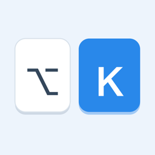
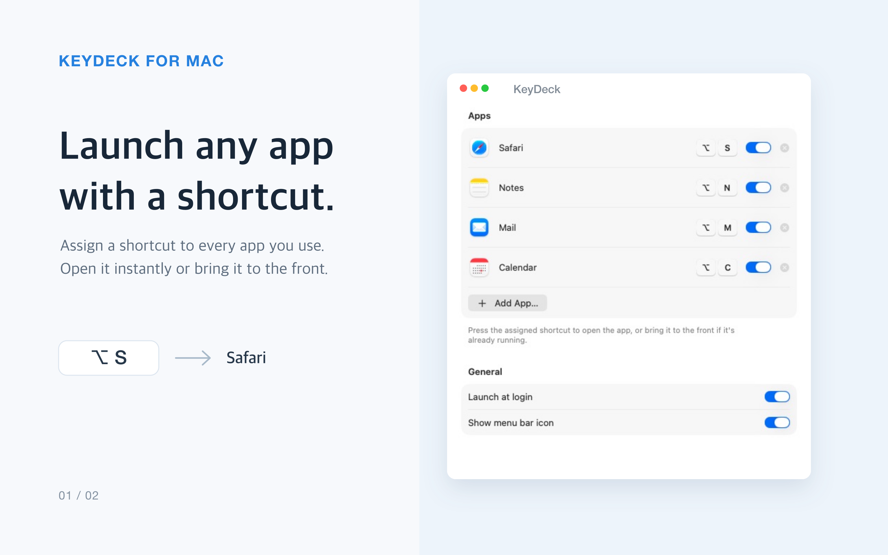
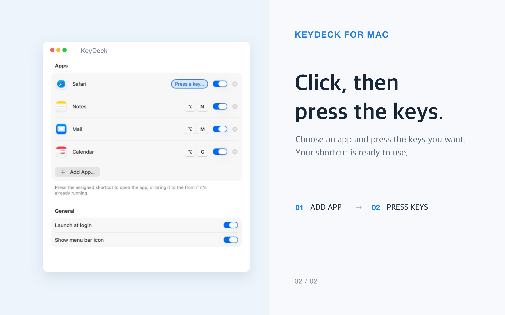

# KeyDeck

**One shortcut. Any app. Instantly.**

A tiny menu bar app that turns your keyboard into a Stream Deck for your Mac.

English · [한국어](README.ko.md)

 

  

## Why KeyDeck

Stop hunting through the Dock or ⌘-Tabbing ten times. Give each app you use every day its own shortcut — <kbd>⌥</kbd><kbd>S</kbd> for Safari, <kbd>⌥</kbd><kbd>N</kbd> for Notes — and it's there the moment you press it.

- **Launch or switch** — Opens the app if it's closed, brings it to the front if it's already running.
- **Any combination** — Mix <kbd>⌃</kbd> <kbd>⌥</kbd> <kbd>⇧</kbd> <kbd>⌘</kbd> with any letter, number or symbol.
- **No conflicts** — Duplicate shortcuts are caught the moment you record them.
- **Stays out of the way** — Lives in the menu bar. Hide the icon entirely if you like.
- **Starts with your Mac** — Optional launch at login.
- **No special permissions** — No Accessibility or Input Monitoring access. Works with any keyboard layout or input method.

  

## Install

1. Download the latest **KeyDeck.dmg** from [Releases](https://github.com/yes2310/KeyDeck/releases/latest).
2. Open it and drag **KeyDeck** into **Applications**.
3. Launch KeyDeck, click **Add App…**, and press your shortcut.

> [!TIP]
> Hid the menu bar icon? Just open KeyDeck again from Spotlight or Applications to bring the settings window back.

## Privacy

KeyDeck collects nothing. Your shortcuts stay on your Mac, it never reads what you type, and it never connects to the internet. Read the full [privacy policy](PRIVACY.md).

## Feedback

Found a bug or have an idea? [Open an issue](https://github.com/yes2310/KeyDeck/issues).
